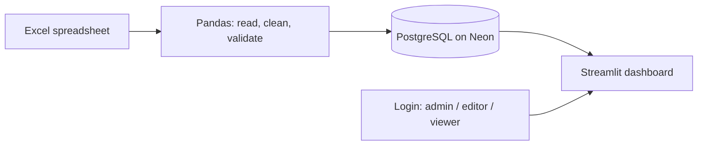

# 🌾 Agro Import System

**Full-stack harvest management system built for Astral Agronegócio (Seibt), 2025/26 harvest.**

It replaces manual spreadsheet work with a system that imports the company's Excel files, validates and stores the data in PostgreSQL, and shows it in an interactive dashboard with login and access levels.

> 🔒 This is a client project, so the source code is private. This repository documents the architecture and the decisions behind it.

## The problem

Harvest operations (purchases, truck weigh-ins, sales, freight, diesel and invoices) were tracked in Excel spreadsheets. The company needed one reliable place for that data, with a dashboard on top and control over who can see and change what.

## The solution

1. The user uploads an Excel file in the web app.
2. Python (Pandas) reads, cleans and validates the data.
3. The data is inserted into PostgreSQL (hosted on Neon).
4. The dashboard reads from the database and updates right away.

## Tech stack

| Layer | Technology |
|---|---|
| Language | Python 3.13 |
| Web interface | Streamlit |
| Database | PostgreSQL (Neon, cloud) with psycopg2 |
| Data handling | Pandas |
| Charts | Plotly |
| Authentication | bcrypt |
| Configuration | python-dotenv, Streamlit Cloud secrets |
| Deployment | Streamlit Cloud, continuous deploy on push |

## Data model

12 tables designed in PostgreSQL, using primary and foreign keys, unique and check constraints:

| Group | Tables |
|---|---|
| Producers and fleet | producers, trucks, rice varieties |
| Operations | weigh-scale entries, purchase orders, purchase installments, sales, freight, diesel, invoices |
| System | import history (audit trail), users |

## Engineering decisions

- **Safe re-imports.** Inserts use `ON CONFLICT DO NOTHING`, so uploading the same spreadsheet twice never creates duplicates.
- **Auditable imports.** Every import is recorded, and users with the right role can undo one.
- **Three access levels.** *Admin* manages users, imports and undoes imports; *editor* imports and undoes; *viewer* only sees the dashboard. Every page checks the session before rendering.
- **Passwords and secrets.** Passwords are stored only as bcrypt hashes. Database credentials live in environment variables locally and in the platform's secrets in production, never in the code. Database connections require SSL.
- **Schema that grew with the project.** The model evolved through `ALTER TABLE` migrations as new spreadsheets and requirements appeared.

## Results (2025/26 harvest)

The system loaded the harvest data for 68 producers, 97 trucks, 610 weigh-scale entries and 51 purchase orders, plus sales, diesel and invoice records.

## My role

I designed and built the whole system during my software development internship at Astral Agronegócio: database modeling, the import pipeline, the dashboard, authentication and deployment.

---

Built by [Sofia Maldaner](https://github.com/sofiadietzmaldaner), with the help of Claude Code.
